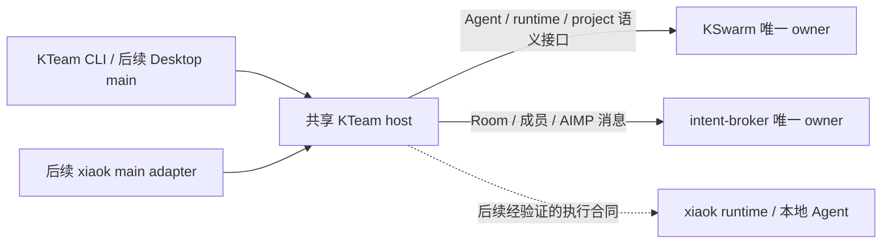

# KTeam

**组建你的 AI 团队，让工作主动向前。**

KTeam 是独立的多 Bot 协作产品。成员具有长期身份、目标和记忆，能在群里分工、交接并交付工作；支持绑定 xiaok 托管执行器与本地 Agent。产品按[已评审设计](docs/design/product-design-v5.md)分阶段实现。

当前版本是 **P0a 的协议与服务基础切片**，可以运行 host/CLI、读取现有 Agent、建立团队并传递 AIMP L0 消息。桌面界面、名字创建 Bot、自动回复、任务执行和主动跟进尚未交付；完整首发仍须通过设计 P0a–P0c 门槛。

## 复用架构



- 从 xiaok **原样复用** Room workspace 协议门禁与外部 Agent 讨论合同，来源和哈希见 [sources.lock.json](sources.lock.json)、[NOTICE](NOTICE)。不复制整个 Electron main。
- KSwarm 持有 Agent 名册和项目事实；intent-broker 持有房间、成员和唯一群转录。生产适配器访问它们的语义 HTTP API，不直接打开它们的数据库、不接管现有后台进程。
- KTeam host 仅持有安装凭据及自己的 owner/schema 元数据。L0 完整信封跟随 broker 消息的 `sourceRef` 一次持久化，没有第二份可写群转录。
- host 使用受限 Unix socket、两套独立客户端凭据、API/schema 握手和 SQLite OS 锁。服务崩溃后由新 owner 回收旧 socket、递增 epoch。当前未安装开机启动项。

## 开发与验证

需要 Node **22.22.0 或更高**。目录结构：

```text
projects/
  kteam/
  kswarm/         # sources.lock.json 固定 revision
  intent-broker/  # sources.lock.json 固定 revision
  mydocs/
    kteam/        # 文档实体，仅在此保存
```

项目中的 `docs -> ../mydocs/kteam` 是相对软链接，文档在 mydocs 仓库独立管理。先将两个源码 sibling 仓库和 mydocs checkout 到 `sources.lock.json` 对应 revision，再运行：

```sh
npm ci
npm run check
node dist/src/cli.js --help
```

集成测试使用锁定的两个仓库的**真实服务源码**。它为 KSwarm 进程分配专用 HOME、数据库及随机 loopback 端口，不调用开发机正在运行的服务，不启动外部 Agent；测试结束按自己记录的 PID 回收。`.npmrc` 禁止为本地包建立 bin shim，避免 npm 改上游源文件权限。

## 连接已有服务

由现有 xiaok host/服务 owner 提供已授权的 broker 与 KSwarm 凭据文件，文件应仅当前用户可读。凭据不进入命令参数、模型上下文、renderer 或 Git。

```sh
export KTEAM_BROKER_TOKEN_FILE=/absolute/private/path/broker.token
export KTEAM_KSWARM_TOKEN_FILE=/absolute/private/path/kswarm.token
node dist/src/cli.js init
node dist/src/cli.js start
```

另一个终端：

```sh
node dist/src/cli.js doctor
node dist/src/cli.js bots
node dist/src/cli.js teams
node dist/src/cli.js team-create --title 经营团队 --goal 准备本周经营复盘 --members agent-id-1,agent-id-2 --id team-request-1
node dist/src/cli.js send --room room-id --text 先一起明确本周目标
node dist/src/cli.js history --room room-id --after 0 --limit 50
```

可用 `KTEAM_DATA_DIR` 指定一个新的专有目录。默认上游为 `127.0.0.1:4318` / `127.0.0.1:4400`；初始化前可设置 `KTEAM_BROKER_URL` / `KTEAM_KSWARM_URL`。不自动读取别的 App 凭据，不自动启动/停止既有服务。

创建团队与发送消息均检查上游协议；配置缺失、上游不通会给出明确原因。写入回执丢失属于“结果未知”，查询后复用原请求 ID，禁止另造 ID 盲重放。

## AIMP 3.1

用户指定的[规范原文](docs/reference/aimp-design-spec-v3.1.md)、schema 与测试向量已纳入仓库。**设计文档版本 3.1 对应信封 `aimp: "1.0"`**。

已实现有界解析、重复键拒绝、安全整数 JCS 子集、四类签名投影与域分隔、Ed25519 向量验证，以及不产生执行效力的 L0 消息。签名工具目前只用于编码验证，未建立生产身份根/会话密钥/定序权威。尚不声称 **AIMP/Core-L2 兼容**；不能仅凭签名向量通过宣称整个 profile 已实现。

完整 Core-L2 的契约、角色、承诺、epoch、effect、归一化及收据激活将在 intent-broker 单一 owner 中实现，接通前执行入口保持关闭。详见[实施计划](docs/design/implementation-plan.md)。
